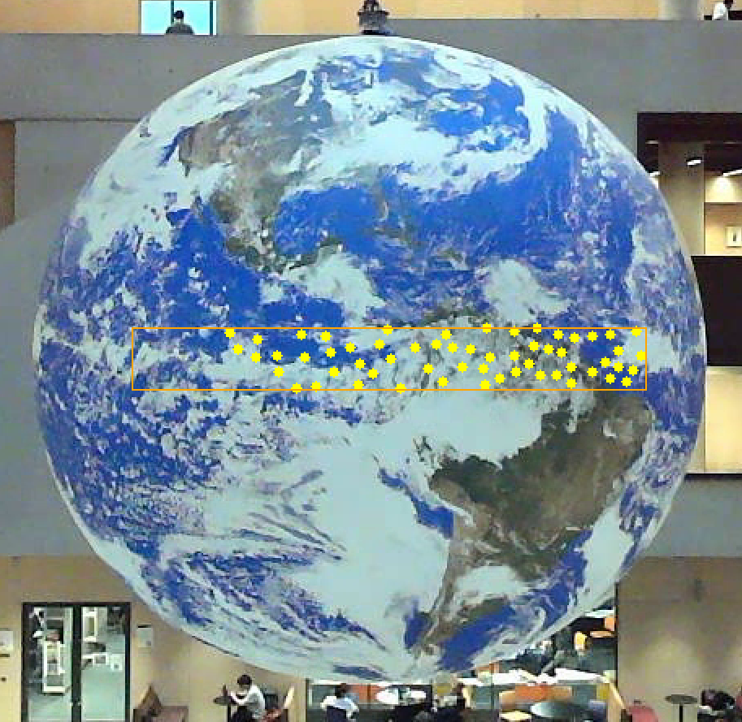
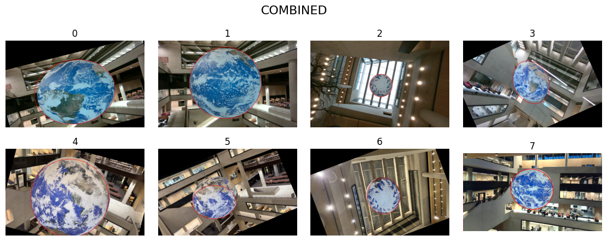
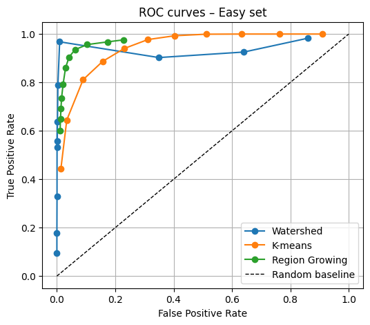
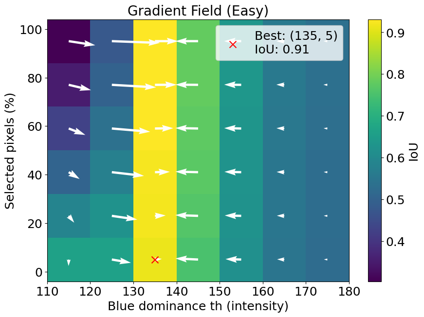
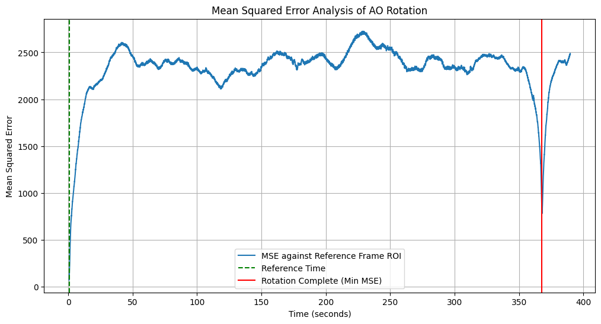
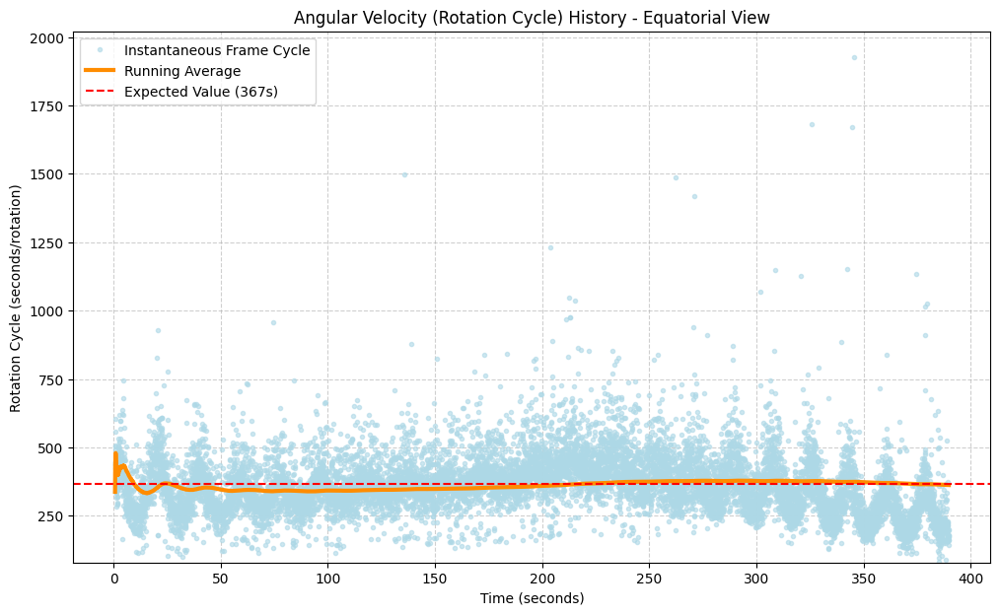
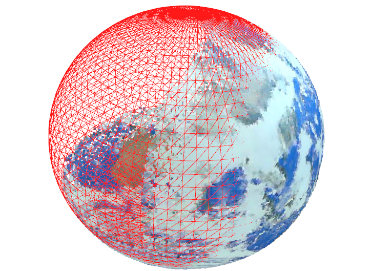
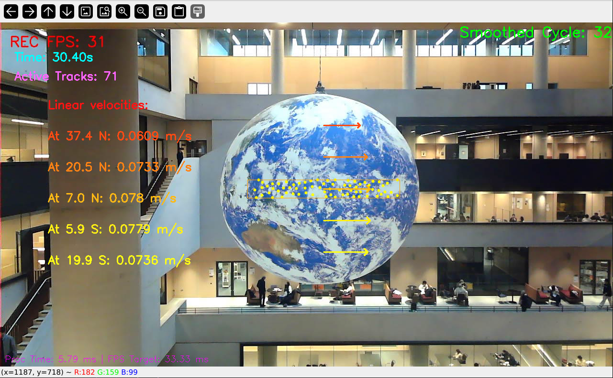

# Globe Vision Measurement

This repository contains the code to measure a **large suspended Earth globe** with cameras and a LiDAR: find it in images, track its centre, estimate its height above the ground, time its rotation, and fit its 3D shape to get the linear speed of its surface at different latitudes.

The work is split into four tasks:

* **segmentation** of the globe with three methods (region growing, watershed, K-means) and a voting scheme that combines them, tuned with ROC curves and an IoU parameter search;
* the **centre and height** of the globe, from a Hough circle fit, template-matching tracking of its swing, and stereo triangulation against a fitted ground plane;
* the **rotation period**, from frame-to-frame mean squared error and from real-time optical flow in a side view and a bottom view;
* the **3D shape and surface speed**, from two merged LiDAR point clouds coloured by the camera, an ellipsoid fit and pixel-to-point projection.

The full write-up is in [report.pdf](./report.pdf). Developed for the final project of the UCL module *COMP0241: Computer Vision* (2025).



## Repository structure

| Task | Code |
|---|---|
| 1 — segmentation, voting, ROC curves and parameter search | `task1.ipynb`, `segmentation.py` |
| 2a — centre of the globe with the Hough circle transform | `task2a.ipynb` |
| 2b — swing of the centre over time | `task2b.ipynb` |
| 2c — height above the ground from stereo | `task2c.ipynb` |
| 3b — manual rotation timing, frame by frame | `task3b.ipynb` |
| 3c, 3d — rotation period and speed of the MSE method | `task3d.ipynb` |
| 3e — real-time angular velocity, side view | `task3e.ipynb` |
| 3f — real-time angular velocity, bottom view | `task3f.ipynb` |
| 4 — ellipsoid fit, radius consistency and surface speed | `task4.ipynb`, `get_colored_globe.py`, `get_point_radius_lat.py` |

* [code](./code/) — the notebooks and scripts above, and the saved IoU grids of the parameter search (`complete.npy`, `easyIoU.npy`);
* [figures](./figures/) — figures from the report;
* [report.pdf](./report.pdf) — the project report.

## Built on

* [OpenCV](https://opencv.org/) — image and video processing, watershed, Hough circles, template matching, Shi–Tomasi corners and KLT optical flow;
* [scikit-learn](https://scikit-learn.org/) — K-means;
* [Open3D](https://www.open3d.org/) — the LiDAR point clouds;
* [SciPy](https://scipy.org/) — the least-squares ellipsoid fit;
* [NumPy](https://numpy.org/) and [Matplotlib](https://matplotlib.org/).

The sensors were a Livox Mid-70 LiDAR, an Arducam camera and a calibrated stereo camera pair.

## Method

**Segmentation.** Three methods each produce a mask of the globe.

* Region growing equalises the image with CLAHE, thresholds blue ocean and white cloud in HSV, and keeps the connected region around the centroid of that prior.
* Watershed builds a blue-dominance map, joins fragments by their solidity and distance from the image centre, and refines the boundary with `cv2.watershed`.
* K-means clusters the blurred image into five groups and picks the one with the highest central density and lowest red value, then trims outliers by distance from its centre of mass.

The combined mask keeps a pixel only when watershed and at least one of the other two agree. The two parameters that move the ROC curves most, the blue-dominance threshold and the share of K-means pixels kept, were then searched on a grid by mean IoU. A gradient field over the IoU grid picks a value in a stable region instead of the single best one.

**Centre and height.** A Hough circle fit after median blurring gives the centre and radius. The swing is tracked with a 20 × 20 px template of a dark spot at the south pole, matched inside a 100 × 100 px window, with a 50 px/s velocity limit that rejects false matches. For the height, points on the bottom of the globe and on the ground are triangulated from a stereo pair with a 1.41 m baseline, a plane is fitted to the ground points by SVD, and the height is the point-to-plane distance.

**Rotation.** The MSE method compares a central region of each frame with a reference frame, and one rotation is the time to the frame with the lowest error. The real-time method tracks Shi–Tomasi corners with KLT optical flow inside a band around the equator, 20% of the globe's height and 80% of its width. It turns the median horizontal displacement into a tangential speed and divides by the globe's radius to get the angular velocity. Features are detected again whenever fewer than 50 remain. The bottom view measures angular displacement in a ring instead.

**Shape and surface speed.** Point clouds from the ground floor and from a sixth-floor balcony are merged with a homogeneous transform and coloured by projecting each point into a calibrated camera image. An ellipsoid with equal x and y axes is fitted to the globe's points by least squares. For the surface speed, a pixel is cast as a ray through the camera, the nearest point of the cloud along that ray gives its 3D position, and the speed is the angular velocity times the point's distance from the rotation axis.

## Results

| Combined mask | FPR | TPR |
|---|---|---|
| Easy 000016 | 0.010 | 0.994 |
| Own image | 0.002 | 0.958 |

| Rotation period | Value |
|---|---|
| Manual timing | 367.43 s |
| MSE method | 367.17 s |

| Measurement | Value |
|---|---|
| Height of the globe's lowest point | 21.29 m, against about 20 m expected |
| Equatorial and polar diameter, ellipsoid fit | 8.42 m and 7.95 m, RMSE 0.0165 m |
| Polar diameter from the image mask | 7.972 m |
| Surface speed | 0.058 m/s near the equator, 0.045 m/s at 37.4° |

* **Segmentation.** Watershed was already close to the ground truth, and the vote added a small TPR gain without new false positives. Region growing held up best across its parameter range and watershed varied most. The chosen parameters are a blue threshold of 135 and 40% of K-means pixels. The mean IoU is 0.03 below the grid's best, but the result is far steadier on distorted images: 15% higher IoU on Hard 000050.
* **Centre.** The centre swings within about 8 px in x and 13 px in y, with a period of about 21 s.
* **Rotation.** The MSE method needs under 5 ms per frame and agrees with the manual timing to 0.26 s. The optical-flow estimate is noisy frame to frame, but its running average settles on the true period, at under 20 ms per frame. The bottom view gives a similar average with more noise, since white cloud and Antarctic ice give few corners to track.
* **Shape.** The globe is an ellipsoid of revolution about its rotation axis, with a polar radius about 5% smaller than the equatorial one. The image-based diameter differs from the ellipsoid fit by 0.022 m.
* **Surface speed.** The speed is highest at the equator and falls towards the poles, as the distance from the axis shrinks.

| | |
|---|---|
|  |  |
|  |  |



| | |
|---|---|
|  |  |

## Running

Install the dependencies:

```
pip install -r requirements.txt
```

The images, videos and point clouds recorded for the project are not included in this repository. The notebooks expect them laid out next to the `code` folder:

```
Dataset_25/{Easy,Medium,Hard,Own}/{images,masks}/
globe_image/ground_floor_rotation_video.avi
globe_image/ground_floor_rotation_video_bottom.avi
globe_image/projection.png
points/6th_floor.pcd
points/ground.pcd
code/
```

Run the notebooks from inside `code`. Tasks 2, 3b, 3d and 3e read their image or video from the `code` folder itself: `image_2a.jpg`, `video_2b.mp4`, `stereo_cam0_2c.jpg` and `AO_Rotation_Recording_full3.mp4`. Task 4 writes the merged, coloured and filtered point clouds to `points/`. Tasks 2b, 2c, 3b, 3e, 3f and 4 open OpenCV or Open3D windows and need a display.

## Author

Amir Gerges, MSc Robotics and Artificial Intelligence, UCL.
